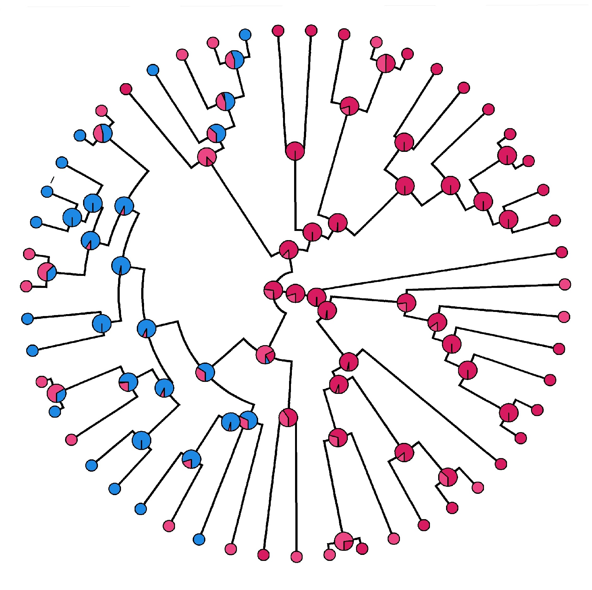

# Disciplina de Métodos Filogenéticos Comparativos

## Objetivos 
### Principal: 
Fundamentar a teoria sobre macroevolução e seus principais métodos de investigação.

### Específicos:
 - Exemplificar hipóteses macroevolutivas;
 - Explicar o potencial e a limitação de modelos no estudo de macroevolução;
 - Demonstrar a aplicação de métodos para responder hipóteses macroevolutivas;
 - Justificar a escolha de métodos com base nas hipóteses de interesse;

## Público-alvo: 
Estudantes de pós-graduação em biologia e áreas afins.

## Pré-requisitos: 
Conhecimentos básicos sobre estatística são necessários para a compreensão do conteúdo teórico.
Familiaridade com a linguagem de programação R é necessária para executar as atividades práticas. 

## Ementa:
Tempo e modo de evolução; modelo de movimento browniano; sinal filogenético; seleção e restrições evolutivas; modelo Ornstein–Uhlenbeck; correlação evolutiva; método dos contrastes filogenéticos; método dos mínimos quadrados generalizados filogenéticos; matriz de taxas evolutivas; cadeia de Markov; matriz de transição; reconstrução de estados ancestrais;

## Metodologia de aula: 
O curso terá aulas teóricas e práticas. As aulas teóricas serão tanto expositivas quanto dialogadas, envolvendo a leitura prévia de textos e a discussão em sala de aula. As práticas serão exercícios de simulação e aplicação de métodos em dados já disponíveis. Todas as aulas práticas necessitarão de computadores com a linguagem de programação R. 

## Método de avaliação: 
Os estudantes serão avaliados com base na sua participação em aula e na elaboração do projeto final. O projeto final envolverá a aplicação justificada de métodos para investigar uma hipótese macroevolutiva.